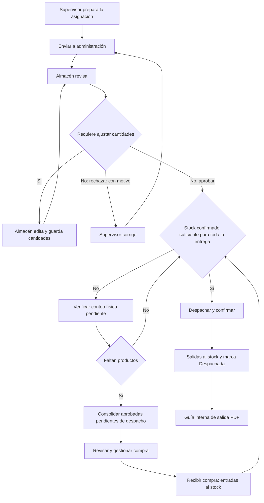

# Flujo funcional de almacén — Segelim Perú

Actualizado: 4 de octubre de 2026. Describe el comportamiento implementado en el aplicativo.

El supervisor solicita los productos del cliente; Almacén revisa y aprueba la solicitud. Si las existencias alcanzan, Almacén despacha directamente. Si faltan productos, consolida las solicitudes aprobadas para gestionar la compra, registra su recepción y después despacha al cliente. Cada despacho genera una guía interna de salida en PDF.

## 1. Responsables y pantallas

| Responsable | Pantalla | Trabajo |
|---|---|---|
| Supervisor | [Asignación mensual](https://segelimperu.iama.pe/almacen/asignacion) | Registrar cantidades, guardar borradores, enviar y corregir solicitudes. Puede trabajar desde teléfono. |
| Almacén | [Productos e inventario](https://segelimperu.iama.pe/almacen/productos) | Mantener productos y precios; confirmar existencias; registrar y consultar movimientos. |
| Almacén | [Clientes](https://segelimperu.iama.pe/almacen/clientes) | Mantener clientes y presupuestos; consultar e imprimir su historial de asignaciones desde el listado. |
| Almacén | [Administración de almacén](https://segelimperu.iama.pe/almacen/revision_asignaciones) | Revisar y aprobar; consolidar y recibir compras; despachar por cliente y abrir la guía PDF. |
| Administrador | Las pantallas anteriores | Puede realizar las acciones de ambos roles. |

**Administración de almacén** abre el mes actual. Tiene las pestañas **Asignaciones** y **Orden de compra** en la misma pantalla. Cambiar el mes consulta ambas; los filtros Cliente y Estado afectan el listado de asignaciones. No hay que entrar a otro módulo para generar la compra o registrar el despacho.

## 2. Preparar clientes, productos y stock

Almacén registra o edita Clientes y Productos mediante **Nuevo** y **Editar**, desde un modal del listado. El cliente debe estar activo y tener su presupuesto configurado; los productos deben estar activos y tener unidad definida. El **precio valorado** calcula la asignación del cliente y el **precio real** calcula la compra.

En Clientes, **Asignaciones** abre el historial del cliente en un modal. La lista de meses aparece a la izquierda y el detalle de la asignación seleccionada a la derecha; en teléfono aparecen uno debajo del otro. **Ver** cambia el detalle y **Imprimir** abre el documento de ese mes. Se muestra primero la más reciente. Cerrar conserva la búsqueda y la página del listado.

En Productos e inventario hay dos acciones distintas por producto:

| Acción | Uso |
|---|---|
| Movimiento | Registrar **Entrada**, **Salida** o **Conteo físico (stock final)**. |
| Historial | Consultar operaciones, motivo, usuario y stock anterior/final. |

Un stock **Por verificar** necesita conteo físico. En Movimiento, elegir **Conteo físico (stock final)** e ingresar la cantidad realmente existente, incluso cero. El conteo establece el saldo final; no suma esa cantidad al saldo anterior. Revisar y confirmar el movimiento.

Sobre el listado se muestran **Valor a precio real** y **Valor a precio valorado**. La columna **Valor del stock S/** equivale al precio valorado multiplicado por el stock confirmado. Las tarjetas siguen la búsqueda y suman todas las páginas; los productos pendientes de conteo quedan fuera del valor.

El interruptor **Solo con stock** muestra productos con existencias confirmadas mayores a cero. Mantenerlo apagado al buscar productos pendientes de conteo o sin existencias.

## 3. Registrar y enviar la asignación — Supervisor

1. Abrir **Asignación mensual** y seleccionar el cliente. Se carga su solicitud del mes o la plantilla para registrarla.
2. Buscar los productos e ingresar las cantidades. Se aceptan hasta tres decimales, con coma o punto. Las cantidades se conservan al buscar o cambiar de página.
3. Revisar total y presupuesto. El exceso de presupuesto y el saldo negativo aparecen como alertas; administración decide si aprueba la solicitud.
4. Usar **Guardar borrador** si se continuará después, o **Enviar a administración** cuando esté lista. No es obligatorio guardar un borrador antes de enviar.
5. Revisar el resumen y confirmar el envío.

Al enviar, la solicitud queda **Pendiente de revisión** y el supervisor ya no puede editar sus cantidades. Almacén puede ajustarlas desde **Revisar asignación**. Guardar o enviar no descuenta ni reserva inventario y no genera automáticamente una orden de compra. Hay una sola asignación por cliente y mes.

## 4. Revisar la solicitud — Almacén

1. Abrir **Administración de almacén → Asignaciones**.
2. En una solicitud pendiente, pulsar **Revisar**.
3. Consultar productos, cantidades, total, presupuesto y observaciones. Si hace falta corregir la estimación del supervisor, editar las cantidades y pulsar **Guardar cantidades** en la cabecera. Los importes y el saldo proyectado se recalculan.
4. Pulsar **Aprobar asignación**, o escribir el motivo y pulsar **Rechazar asignación**. Los cambios de cantidades deben guardarse antes de decidir.

Si se rechaza, el supervisor ve **Necesita corrección**, corrige la misma asignación y vuelve a enviarla. Si se aprueba, queda **Aprobada**. Almacén puede ajustar sus cantidades mientras no esté despachada ni incluida en una compra recibida; conserva el estado, los precios guardados y el presupuesto. Cada cambio registra usuario y cantidades anteriores/nuevas en el historial. Una cantidad cero excluye ese producto de compra y despacho y puede restaurarse antes del bloqueo. Debe conservarse al menos un producto solicitado. Guardar cantidades y aprobar afectan los importes y saldos presupuestarios, pero no el stock físico.

Si se ajusta una aprobada incluida en una compra borrador, usar **Actualizar consolidado** antes de recibirla. El servidor rechaza la recepción si las cantidades consolidadas quedaron desactualizadas.



## 5. Comprar solo el faltante — Almacén

Si el stock confirmado ya alcanza para todos los productos del cliente, pasar al despacho. Si faltan existencias:

1. Abrir la pestaña **Orden de compra** del mes.
2. Pulsar **Consolidar aprobadas**. Si existe una compra borrador, usar **Actualizar consolidado**.
3. Revisar el consolidado por producto: **Solicitado**, **Stock al consolidar**, **Sugerido** y **A adquirir**.
4. Ajustar **A adquirir** cuando corresponda, completar proveedor y observaciones, y pulsar **Guardar**.
5. Usar **Imprimir** o **Excel** para gestionar la compra.

La consolidación reúne todas las asignaciones aprobadas de clientes activos del mes que todavía no fueron despachadas, aunque el listado de Asignaciones esté filtrado por un solo cliente. Las pendientes de revisión, rechazadas y ya entregadas no forman parte de la nueva necesidad.

```text
Solicitado = suma de cantidades aprobadas pendientes de despacho
Sugerido a comprar = máximo(0, solicitado − stock confirmado)
```

El interruptor **Por cliente** muestra una columna por cliente incluido y su cantidad solicitada. La suma coincide con **Solicitado**; **A adquirir** considera el stock y puede tener ajustes. Cambiar esta vista conserva lo ingresado. Imprimir y Excel siguen la vista elegida.

Consolidar y guardar la compra no modifican el stock. Si hay existencias por verificar, primero realizar el conteo y **Actualizar consolidado**: mientras ese stock siga pendiente, no se descuenta al calcular la compra.

## 6. Registrar la recepción del proveedor — Almacén

1. Cuando llegue físicamente la compra, abrir **Orden de compra** del mes.
2. Verificar las cantidades **A adquirir** que se van a registrar como recibidas.
3. Pulsar **Recibir compra**, revisar el resumen y confirmar.
4. Consultar el resultado y, si hace falta, las entradas en **Productos e inventario → Historial**.

La recepción suma las cantidades indicadas al stock y deja la compra **Recibida**. No se puede recibir dos veces ni editar una compra recibida. Si falla una línea, se revierte la recepción completa.

Si se aprobaron nuevas asignaciones o se despachó alguna incluida después de consolidar, se exige **Actualizar consolidado** antes de recibir. Si el inventario previo estaba por verificar, recibir la compra no confirma ese saldo: todavía corresponde hacer el conteo físico.

## 7. Despachar al cliente y generar su guía — Almacén

1. Abrir **Administración de almacén → Asignaciones** y localizar la solicitud aprobada.
2. Pulsar **Despachar**. También está disponible desde su detalle.
3. En el modal, revisar cliente, mes, productos, cantidades **A entregar** y **Stock**.
4. Si todos los productos cumplen, pulsar **Confirmar despacho** al registrar la entrega completa.
5. La **Guía PDF** se abre automáticamente al confirmarse el despacho. Descargar o imprimir el documento y completar las firmas de entrega/recepción. El botón **Guía PDF** permite abrirlo nuevamente.

La guía se abre en otra pestaña y Administración conserva la búsqueda y la página. Si el navegador bloquea nuevas pestañas, el documento aparece dentro del modal. Si la confirmación falla, se cierra la pestaña de espera y el formulario muestra el problema.

El despacho requiere asignación aprobada, cliente activo, productos activos, unidades coincidentes, conteo confirmado y existencias suficientes para **todos** los productos. Si una sola línea no cumple, se muestra el problema y no se habilita la confirmación. Al confirmar, el servidor vuelve a verificar todo: no se permite una entrega parcial ni un stock negativo.

La operación descuenta todas las cantidades del cliente y registra una salida por producto con referencia al despacho y a la asignación. La fila conserva **Aprobada** y agrega **Despachada**; el botón cambia a **Guía PDF**. Las cantidades entregadas dejan de formar parte de futuras consolidaciones del mes.

La guía contiene número, cliente, fecha, asignación, productos, unidades, marcas, cantidades y espacios para firmas. Sus datos se conservan aunque después se edite el cliente o el catálogo. Abrirla nuevamente no descuenta stock; un reintento del mismo despacho devuelve la guía existente sin duplicar las salidas.

Si había una compra borrador que incluía esa asignación, se muestra un aviso para **Actualizar consolidado** antes de recibir. Al actualizar, se retira la solicitud ya entregada. Se conservan los ajustes manuales de compra de los productos que sigan incluidos.

## 8. Ejemplo completo con inventario

Supongamos un producto en LTR, con stock confirmado de **6.000**, y dos solicitudes aprobadas del mes: Cliente A pide **5.000** y Cliente B pide **3.000**. Los demás productos de sus solicitudes también cumplen las condiciones de entrega.

| Paso | Resultado | Stock LTR |
|---|---|---:|
| Aprobar ambas solicitudes | Demanda de 8.000; todavía no hay salidas. | 6.000 |
| Consolidar aprobadas | Sugiere comprar 8.000 − 6.000 = 2.000. | 6.000 |
| Guardar la compra | Queda registrada la cantidad a adquirir. | 6.000 |
| Recibir 2.000 del proveedor | Registra entrada y cierra la compra. | 8.000 |
| Despachar al Cliente A | Registra salida de 5.000 y su guía PDF. | 3.000 |
| Despachar al Cliente B | Registra salida de 3.000 y otra guía PDF. | 0.000 |
| Reimprimir ambas guías | Consulta los despachos existentes. | 0.000 |

También puede entregarse primero al Cliente A, porque el stock inicial de 6.000 alcanza para sus 5.000. Quedarían 1.000 y una demanda pendiente de 3.000 del Cliente B. Si la compra todavía está en borrador, **Actualizar consolidado** retira al Cliente A y calcula el mismo faltante de 2.000.

## 9. Consultas y documentos

| Necesidad | Dónde consultarla |
|---|---|
| Solicitud y presupuesto del cliente | Asignación mensual o detalle de Asignaciones; Imprimir y Excel. |
| Compra total o distribución por cliente | Administración → Orden de compra; interruptor Por cliente, Imprimir y Excel. |
| Entrega efectivamente registrada al cliente | Asignaciones → Guía PDF. |
| Stock actual y movimientos | Productos e inventario → Movimiento / Historial. |
| Valor del almacén y de cada producto | Productos e inventario → tarjetas de valor y columna Valor del stock S/. |
| Solicitudes o compra de otro período | Selector Mes de Administración de almacén. |

Los listados reutilizan los controles de DataTables para buscar y exportar Excel/PDF en español. Estas exportaciones sirven para consultar las tablas; la **Guía PDF** del despacho identifica una entrega concreta ya registrada.

## 10. Recorrido con los datos de demostración

En **Asignación mensual**, los clientes identificados como **DEMO** permiten recorrer borradores, solicitudes pendientes, devoluciones y aprobadas. Por ejemplo, **DEMO · Oficina Norte** tiene el borrador inicial y **DEMO · Colegio Este**, una solicitud para corregir. Los ejemplos son persistentes: su estado puede cambiar al operar sobre ellos.

En [Administración de septiembre de 2026](https://segelimperu.iama.pe/almacen/revision_asignaciones?periodo=2026-09), las dos entregas de demostración anteriores muestran **Despachada** y **Guía PDF**. En **Orden de compra** se puede consultar su compra recibida y alternar el detalle **Por cliente**. En Productos, buscar `DEMO` y abrir **Historial** para ver las entradas y salidas asociadas.

## 11. Alcance actual

Se implementaron una asignación por cliente/mes, una compra por mes con recepción completa y un despacho completo por asignación. Las compras recibidas y los despachos confirmados quedan cerrados. Recepciones parciales, ampliaciones de compras recibidas, despachos parciales y anulación/devolución de despachos no tienen un flujo implementado.

Los movimientos manuales de inventario siguen disponibles, pero no generan el vínculo de despacho ni la guía de una asignación. Para registrar la entrega de una solicitud aprobada, usar **Despachar** desde Administración de almacén.

El detalle técnico, permisos, instalación y verificaciones está en [ALMACEN_IMPLEMENTACION.md](ALMACEN_IMPLEMENTACION.md).
