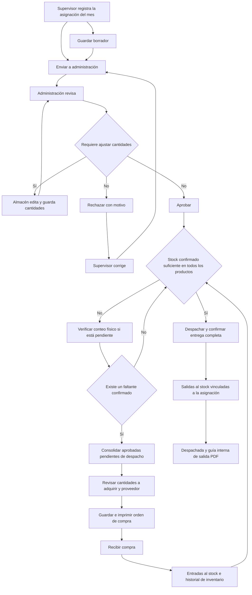

# Implementación del módulo de almacén — Segelim Perú

Fecha del informe: 4 de octubre de 2026.

Este documento describe el trabajo realizado en el aplicativo existente: productos, inventario, clientes, asignaciones mensuales, revisión administrativa, órdenes de compra con ingreso al stock y despachos por cliente con guía interna de salida en PDF.

Para capacitación y operación diaria, consultar el [flujo funcional de almacén](ALMACEN_FLUJO_FUNCIONAL.md), con responsables, botones, ejemplos y efecto de cada acción sobre el inventario.

## 1. Alcance y decisiones acordadas

- Implementación web dentro del sistema actual, utilizando su sesión, diseño y menú.
- Dos precios independientes por producto: **precio real de compra** y **precio valorado**, este último con IGV incluido.
- Los 250 productos importados se inicializaron con el mismo importe en ambos precios, por indicación del usuario. Después pueden editarse por separado.
- Inventario incluido desde esta etapa, con stock inicial y movimientos de entrada, salida y ajuste.
- Presupuesto máximo por cliente y saldos acumulados utilizados como alertas.
- Una sola asignación por cliente y mes.
- Estados de asignación: **Borrador, Publicado, Aprobado y Rechazado**.
- Dos flujos de trabajo: registro por supervisor y revisión/consolidación por administración.
- Despacho completo por asignación aprobada, con stock confirmado suficiente en todos los productos, salidas vinculadas y guía interna de salida en PDF. La entrega se registra por separado del estado de aprobación.
- Roles operativos **Supervisor (`SP`)** y **Almacén (`AL`)**, con menús y permisos separados. Los administradores existentes `AD` y `SA` conservan ambos flujos.
- No se creó el usuario de Paul durante este trabajo.

## 2. Fuente de datos y carga inicial

Se revisó el archivo compartido:

`VALORIZACION_PROVINCIAS_5_-_PAUL_ALMACEN_2026.xlsx`

[Archivo Excel original](https://staticfileszyxme.s3.us-east.cloud-object-storage.appdomain.cloud/uploads/1790985529496/VALORIZACION_PROVINCIAS_5_-_PAUL_ALMACEN_2026.xlsx)

La plantilla contiene cuatro hojas por cliente, con las columnas descripción, unidad, marca, cantidad, precio y total; agrupa productos en **Materiales** e **Implementos** e incluye presupuesto y diferencia disponible.

Se cargaron inicialmente **250 productos**, consolidando las hojas por descripción, unidad y marca. Las presentaciones y marcas diferentes se mantienen como productos separados.

Cinco productos carecían de unidad en la fuente y se identificaron con `POR DEFINIR`. Su unidad debe completarse antes de publicar una asignación que los incluya.

También se cargaron estos clientes y presupuestos iniciales:

| Cliente | Grupo | Presupuesto máximo mensual |
|---|---|---:|
| IPESA PIURA | Grupo 2 | S/ 400.00 |
| IPESA CAMIONES PIURA | Grupo 2 | S/ 150.00 |
| IPESA CHICLAYO | Grupo 4 | S/ 350.00 |
| CGM RENTAL CHICLAYO | Grupo 4 | S/ 120.00 |

Las cantidades solicitadas en el Excel no se utilizaron como existencias. El stock de los productos importados quedó por verificar mediante conteo físico.

No se importaron asignaciones históricas: los encabezados del archivo mezclan julio, agosto y septiembre. Se requiere confirmar esos períodos antes de una carga histórica.

## 3. Módulos disponibles en el menú

| Opción | Función | Ruta |
|---|---|---|
| Productos e inventario | Catálogo, precios y movimientos | `almacen/productos` |
| Clientes | Clientes, presupuestos y datos de contacto | `almacen/clientes` |
| Asignación mensual | Plantilla del mes actual para registrar y publicar | `almacen/asignacion` |
| Administración de almacén | Asignaciones y compra del mes: revisión, consolidación, recepción, despacho por cliente y guía PDF | `almacen/revision_asignaciones` |

## 4. Productos e inventario

### Catálogo

Cada producto dispone de código, descripción, categoría, marca, unidad/presentación, precio real, precio valorado y estado activo/inactivo. El listado añade **Valor del stock S/**: precio valorado × stock confirmado. Sobre la tabla aparecen dos tarjetas compactas con el valor total a precio real y a precio valorado; siguen la búsqueda y Solo con stock, sin limitarse a la página visible.

Al crear un producto se puede registrar su stock inicial, incluido cero. Se genera un movimiento de apertura con el usuario y la cantidad registrada.

Si el precio real se deja vacío al guardar, se utiliza el precio valorado. Un precio real registrado puede ser diferente del valorado.

El listado reutiliza **DataTables** para buscar por código, descripción, marca o categoría y paginar con opciones de **10, 25, 50 o 100 productos**. Incluye activos e inactivos, con el estado en su columna y sin selector de estado. Conserva la búsqueda al cambiar de página. Selector, contador y navegación aparecen juntos al pie, con la misma configuración que Clientes, Asignaciones y Administración. Excel y PDF exportan todas las filas de la búsqueda, incluidas las de otras páginas. Nuevo y Editar abren un modal de Bootstrap para guardar desde el listado.

### Movimientos

- **Entrada:** suma la cantidad recibida.
- **Salida:** resta la cantidad retirada y rechaza cantidades superiores al stock disponible.
- **Ajuste:** establece el stock físico final contado.

El historial conserva tipo, cantidad, motivo, usuario, fecha, stock anterior y stock final. Editar el catálogo no modifica las existencias.

Productos tiene dos acciones independientes: **Movimiento** abre el formulario y **Historial** muestra directamente los registros, sin campos ni controles de guardado. Ambas usan el modal de Bootstrap y conservan búsqueda y página del listado. Registrar movimiento presenta una revisión con stock actual, cantidad, stock final y motivo; Corregir permite volver a los campos y Confirmar movimiento registra la operación. El stock y fila del producto se actualizan sin salir del listado; al abrir Historial se consultan los registros actualizados. Las rutas directas conservan su pantalla independiente.

El formulario exige elegir el movimiento: Entrada, Salida o Conteo físico; no deja un ajuste seleccionado por defecto. Muestra el stock final previsto y solicita revisar el producto, cantidad y motivo antes de registrar. Un conteo físico establece el stock final y se distingue de una entrada que suma existencias.

Los productos importados requieren un primer ajuste para confirmar su inventario antes de las entradas y salidas manuales. Los productos inactivos no admiten movimientos. No se permite cambiar la unidad de un producto que tenga stock.

## 5. Clientes

La opción del menú se llama únicamente **Clientes**.

Incluye código, nombre, RUC opcional, grupo, supervisor responsable, contacto, dirección de entrega, presupuesto máximo mensual, saldo acumulado inicial, estado y referencia del documento de baja.

Registro y edición se realizan en un modal desde el listado. Se conservan búsqueda y paginación de DataTables. El listado incluye activos e inactivos y muestra el estado en su columna; se retiró el selector de estado para ahorrar espacio.

El saldo inicial puede ser positivo o negativo y representa el saldo anterior al primer período registrado en el sistema.

Dar de baja exige la referencia de un documento oficial. La baja conserva el historial e impide registrar o modificar asignaciones del cliente inactivo. Se registra la referencia documental; no se implementó adjuntar el archivo del documento.

## 6. Asignación mensual

### Apertura y presentación

Al ingresar se muestra directamente la plantilla del **mes actual**, priorizando un cliente activo que aún no tenga asignación en ese mes. No existe el botón «Mostrar plantilla».

El selector de cliente carga automáticamente su asignación existente o la plantilla para registrarla. Los estados de los clientes se muestran en ese selector.

La pantalla utiliza el formato del Excel:

| Descripción | Unidad | Marca | Cantidad | Precio valorado | Total |
|---|---|---|---:|---:|---:|

Los productos se agrupan en Materiales e Implementos, con subtotales por categoría.

La presentación se adaptó para usuarios con poca experiencia y para teléfonos:

- Tabla en escritorio y tarjetas por producto en móvil, con descripción, unidad, marca, cantidad, precio e importe. Ambas vistas utilizan el mismo campo de cantidad por producto.
- Barra inferior visible con total, estado de guardado, **Guardar borrador** y **Enviar a administración**, según el estado del registro. El contenido reserva espacio para no quedar tapado por esa barra.
- **Volver**, **Imprimir** y **Excel** aparecen en una cabecera común, con iconos y texto. Los documentos utilizan la versión guardada; Excel descarga un `.xlsx` con formato.
- Pantallas sin párrafos de instrucciones permanentes. Presupuesto visible y detalle de saldos desplegable, con un resumen compacto. Los estados se muestran con etiquetas y el motivo de devolución solo aparece cuando existe; las alertas de presupuesto y saldo permanecen visibles aunque el resumen esté cerrado.
- **10 productos por página**, con opciones de 20 y 50. Selector, contador y navegación de DataTables juntos al pie; en móvil se muestran «Anterior», la página actual y «Siguiente».
- Búsqueda por producto, unidad o marca, sin distinguir acentos; filtro «Solo solicitados» con contador. Se retiró el botón permanente «Limpiar filtros»; el acceso «Mostrar todos los productos» sigue disponible únicamente cuando no hay coincidencias.
- Cantidades conservadas al cambiar de página o filtrar. Se acepta coma o punto decimal, con hasta tres decimales. Los botones − y + cambian la cantidad de uno en uno y actualizan los importes; el mínimo es cero. Las cantidades negativas se rechazan en pantalla, controlador y modelo.
- Totales calculados sobre todas las líneas, incluidas las ocultas por paginación.
- Mensajes cuando no hay coincidencias y acceso para volver a mostrar todos los productos.
- Errores que identifican el producto, conservan el texto ingresado y permiten acceder a él aunque esté en otra página.
- Observaciones desplegables, controles táctiles de al menos 44 px en móvil y zoom permitido.

Guardar un borrador sigue siendo una acción manual: no hay guardado automático ni recuperación offline. Los cambios pendientes se indican en pantalla y se advierten al cambiar de cliente, salir o cerrar/recargar la pestaña; el aviso nativo al cerrar depende del soporte y la interacción previa del navegador. Pulsar Enter en la búsqueda o en una cantidad no envía el formulario.

Antes de enviar se muestra un resumen con cliente, mes, productos, total y presupuesto, explicando que el supervisor ya no podrá editar las cantidades durante la revisión. Almacén puede ajustarlas desde Revisar asignación. En la interfaz, **Publicado** se muestra como «Pendiente de revisión» y **Rechazado** como «Necesita corrección». Los estados internos y las reglas de aprobación mantienen los nombres originales.

### Presupuesto, precios y saldos

El presupuesto máximo se copia del cliente al crear la asignación y se conserva en ella. La pantalla de registro no permite elevarlo, y el servidor no acepta un máximo alterado desde el navegador.

```text
Total de línea = cantidad × precio valorado
Total general = suma de los totales de línea
Diferencia del mes = presupuesto máximo − total general
Saldo anterior = saldo inicial + diferencias de asignaciones aprobadas de meses anteriores
Saldo acumulado proyectado = saldo anterior + diferencia del mes actual
```

El exceso mensual se muestra en rojo y el saldo acumulado negativo genera una alerta. Estos avisos no bloquean guardar o publicar; la administración decide su aprobación.

Solo las asignaciones **aprobadas** afectan los saldos de meses posteriores. No se generan presupuestos para meses sin asignación registrada.

Cada detalle conserva descripción, categoría, marca, unidad y ambos precios. Editar cantidades de líneas existentes mantiene los precios guardados, aunque cambie el catálogo.

Los totales se recalculan en servidor. Se permiten importes de hasta dos decimales y cantidades de hasta tres.

### Estados

| Estado | Comportamiento |
|---|---|
| Borrador | Editable; se puede guardar y publicar. |
| Publicado | Enviado a administración; el supervisor no puede editarlo. Almacén puede ajustar y guardar cantidades en la revisión. |
| Rechazado | Muestra el motivo y permite corregir y volver a publicar. |
| Aprobado | Disponible para compra y despacho. Almacén puede ajustar cantidades hasta su despacho o inclusión en una compra recibida. |

Publicar requiere al menos un producto con cantidad mayor a cero y unidades definidas. Corregir un rechazo conserva el mismo registro del cliente y mes.

La base de datos impide duplicar cliente/período. Las revisiones detectan ediciones simultáneas para evitar sobrescrituras.

### Salidas documentales

La impresión muestra únicamente productos con cantidad positiva, subtotales y resumen. Permite imprimir o guardar PDF desde el navegador.

La exportación documental genera **Excel `.xlsx`** con cabecera, datos del cliente/período/estado, filas alternadas, subtotales por categoría y resumen financiero. Las cantidades son números con tres decimales y los importes tienen formato de soles. Incluye una hoja de detalle con filtros y cabecera fija. Utiliza precios, cantidades y presupuesto de la asignación guardada.

## 7. Administración de almacén

La bandeja muestra por defecto las asignaciones enviadas del mes actual: publicadas, aprobadas y rechazadas. Incluye filtros por cliente, estado y mes para consultar períodos anteriores.

Muestra cantidades de registros por revisar y aprobados. Los que exceden el presupuesto máximo aparecen resaltados en rojo, indicando el exceso.

Desde el detalle, administración puede:

1. Consultar los productos, cantidades, importes y observaciones.
2. Editar y guardar las cantidades estimadas, conservando precios y presupuesto.
3. Aprobar la asignación.
4. Rechazarla con un comentario obligatorio.
5. Consultar el historial de estados y ajustes de cantidades.
6. Despachar una asignación aprobada cuando todo el stock esté confirmado y alcance; después, consultar su guía interna de salida en PDF.

El historial conserva usuario, fecha, estado anterior, estado nuevo y comentario. No se permiten decisiones repetidas sobre una revisión ya resuelta.

## 8. Consolidación y orden de compra

Desde administración se pueden consolidar **todas las asignaciones aprobadas del mes de clientes activos pendientes de despacho** en una sola orden, independientemente del filtro de cliente mostrado en la bandeja. Las ya despachadas se excluyen para evitar volver a comprar cantidades entregadas.

La orden tiene un identificador mensual como `OC-202610` y es única por período.

### Cálculo y ajustes

```text
Solicitado por producto = suma de cantidades aprobadas pendientes de despacho
Cantidad sugerida a comprar = máximo(0, solicitado − stock confirmado)
Importe de compra = cantidad a adquirir × precio real
```

La orden muestra solicitado, stock al consolidar, cantidad sugerida, cantidad a adquirir, precio real y total.

Administración puede modificar las cantidades a adquirir, registrar proveedor y observaciones, guardar la orden e imprimirla para su gestión.

Mientras sea borrador, «Actualizar consolidado» incorpora nuevas aprobadas pendientes de despacho, retira las ya entregadas y recalcula las existencias. Conserva las cantidades ajustadas manualmente de los productos que continúan incluidos y mantiene la misma orden del mes. Si todas las incluidas fueron despachadas, la actualización deja la orden sin líneas y con total cero.

Los productos con stock por verificar se señalan y no se descuentan de la necesidad de compra. La orden conserva la relación con las asignaciones incluidas.

### Recepción e ingreso al stock

Crear, consolidar o guardar la orden **no incrementa el inventario**.

El botón **Recibir compra** muestra una confirmación con la orden, proveedor, importe y cantidades por producto. Explica que la recepción cierra la orden. Al confirmar, guarda las cantidades indicadas y genera entradas de inventario por cada producto recibido. La edición de la orden muestra cambios pendientes y pide guardarlos antes de imprimir o actualizar el consolidado.

Si desde la consolidación cambiaron las asignaciones aprobadas disponibles o alguna fue despachada, la recepción exige **Actualizar consolidado**. El listado de aprobadas pendientes de entrega se comprueba nuevamente en el servidor.

```text
Stock nuevo = stock anterior + cantidad adquirida recibida
```

La recepción se ejecuta en una transacción. Si falla una línea, se revierte toda la operación. Los movimientos identifican la orden, el usuario y las existencias anteriores y finales.

Una orden recibida queda bloqueada: no se puede recibir nuevamente ni regenerar. Esto evita duplicar stock.

La recepción suma las unidades compradas, pero no confirma automáticamente un inventario preexistente que estaba por verificar; ese conteo sigue pendiente.

Esta entrega registra una recepción completa de las cantidades indicadas. No se implementaron recepciones parciales ni ampliación de una orden después de recibida.

## 9. Flujo operativo implementado



Las asignaciones, su publicación y su aprobación no descuentan ni reservan stock. Consolidar considera las existencias para calcular el faltante; tampoco las descuenta. **Recibir compra** aumenta el stock. **Confirmar despacho** descuenta la entrega completa al cliente y genera su guía PDF; la compra es opcional cuando las existencias ya alcanzan.

| Acción | Efecto sobre el inventario |
|---|---|
| Guardar borrador, enviar, ajustar cantidades, aprobar o rechazar | Ninguno. |
| Consolidar aprobadas, ajustar o guardar compra | Ninguno; calcula o guarda cantidades a adquirir. |
| Recibir compra | Suma las cantidades recibidas y registra entradas. |
| Confirmar despacho | Resta todas las cantidades aprobadas del cliente y registra salidas. |
| Abrir, descargar o reimprimir la guía PDF | Ninguno; utiliza el despacho ya registrado. |
| Movimiento manual: Entrada / Salida / Conteo físico | Suma / resta / establece el stock final, con motivo e historial. |

## 10. Tablas creadas

| Tabla | Finalidad |
|---|---|
| `almacen_productos` | Catálogo, dos precios, existencias y estado de verificación. |
| `almacen_movimientos` | Aperturas, entradas, salidas y ajustes de stock. |
| `almacen_clientes` | Clientes, presupuestos, saldo inicial y datos operativos. |
| `almacen_asignaciones` | Cabecera mensual, presupuesto, total, estado y revisión. |
| `almacen_asignacion_detalles` | Cantidades y datos/precios históricos por producto. |
| `almacen_asignacion_eventos` | Historial de publicación, aprobación y rechazo. |
| `almacen_compras` | Orden mensual, proveedor, importe y recepción. |
| `almacen_compra_asignaciones` | Relación entre la orden y las asignaciones consolidadas. |
| `almacen_compra_detalles` | Necesidad, stock considerado y cantidades a adquirir. |
| `almacen_despachos` | Una entrega por asignación, cliente y datos de entrega históricos. |
| `almacen_despacho_detalles` | Productos entregados, cantidades, existencias y vínculo con cada salida de inventario. |

Se utilizan InnoDB, claves foráneas y restricciones de unicidad para cliente/mes y orden/mes. Los campos de publicación y revisión se añadieron a la tabla de asignaciones creada durante este trabajo.

## 11. Archivos principales e instalación

### Código

- `application/controllers/Almacen.php`
- `application/models/Almacen_model.php`
- `application/models/Almacen_clientes_model.php`
- `application/models/Almacen_asignaciones_model.php`
- `application/models/Almacen_compras_model.php`
- `application/models/Almacen_despachos_model.php`
- `application/libraries/Almacen_guia_pdf.php`, reutilizando FPDF incluido en el aplicativo.
- Vistas en `application/views/almacen/`.
- Opciones del menú en `application/views/layout/menu.php`.
- Catálogo inicial en `application/data/almacen_productos_iniciales.php`.

### Instaladores

Las tablas y las cargas iniciales ya fueron ejecutadas en la base de datos configurada en el aplicativo. Para reproducir la instalación:

```sh
php application/sql/instalar_almacen.php
php application/sql/instalar_clientes_asignaciones.php
```

El segundo instalador incluye el flujo de estados, compras y despachos. También pueden ejecutarse individualmente:

```sh
php application/sql/instalar_flujo_asignaciones.php
php application/sql/instalar_compras.php
php application/sql/instalar_despachos.php
```

Los instaladores solo se ejecutan por consola. Consultan la configuración de base de datos existente y evitan duplicar las cargas iniciales o sobrescribir registros ya editados.

No se incluyen credenciales en este informe.

## 12. Verificaciones realizadas

Pruebas del modelo con tablas temporales, sin modificar los registros operativos:

```sh
php tests/almacen_test.php
php tests/almacen_asignaciones_test.php
php tests/almacen_compras_test.php
php tests/almacen_despachos_test.php
```

Se comprobaron:

- Stock inicial, movimientos con decimales, ajustes y rechazo de salidas sin existencias suficientes.
- Conservación del stock al editar el catálogo.
- Restricciones de códigos duplicados y cliente/mes.
- Precios históricos, saldos y presupuesto máximo protegido.
- Borrador, publicación, rechazo, corrección, nueva publicación y aprobación.
- Bloqueo de registros publicados/aprobados y de revisiones antiguas.
- Consolidación de varios clientes y descuento del stock confirmado.
- Ajustes manuales, una orden por mes y recepción sin duplicados.
- Reversión completa de una recepción fallida.

También se verificaron por HTTP, en el servidor, los formularios, los flujos administrativos, la impresión, el CSV disponible en esa etapa, la recepción y la protección por sesión/token. Los datos temporales creados para estas verificaciones fueron eliminados.

Se ejecutó el JavaScript de la plantilla con un DOM simulado para comprobar las 10 filas visibles, la paginación, la conservación de cantidades, los filtros y los totales de todas las páginas. Esta comprobación inicial no sustituyó una revisión visual en todos los tamaños de pantalla. Posteriormente se añadieron las verificaciones de UX siguientes.

## 13. Pendientes y límites actuales

1. Reemplazar las cuentas genéricas por las identidades definitivas; crear o habilitar el usuario de Paul si corresponde. Los roles Supervisor y Almacén ya están aplicados.
2. Completar las unidades que falten y confirmar físicamente el stock inicial.
3. Completar datos de contacto, RUC, dirección, supervisores y saldos iniciales que no estaban en el Excel.
4. Confirmar los períodos antes de importar asignaciones históricas.
5. Integrar el flujo de almacén con el aplicativo de operaciones en la segunda fase acordada.
6. Ampliar a recepciones parciales o compras adicionales posteriores a la recepción si el proceso lo requiere.
7. Ampliar a despachos parciales o anulación/devolución de un despacho si el proceso lo requiere. Actualmente la entrega es completa y única por asignación, con guía PDF.

Las áreas de servicios especiales, uniformes y maquinaria con mantenimiento/certificados se describieron en la reunión, pero no se desarrollaron como módulos nuevos dentro de este alcance.


## 14. Verificación de la mejora de UX

Archivos de presentación compartidos: `assets/css/almacen.css` y `assets/js/almacen-ux.js`, cargados únicamente para el módulo de almacén. El layout permite zoom y declara el idioma español.

Pruebas del controlador, sin base de datos:

```sh
php tests/almacen_ux_test.php
```

Pruebas de navegador con las vistas y el layout reales, datos de prueba y todas las solicitudes HTTP interceptadas:

```sh
node tests/almacen_ux_browser_test.cjs
```

La prueba de navegador requiere Playwright y Chromium instalados; `PLAYWRIGHT_MODULE` permite indicar un módulo Playwright disponible fuera del proyecto. `ALMACEN_UX_SCREENSHOTS` permite guardar capturas en un directorio elegido. `tests/almacen_ux_fixture.php` solo se ejecuta por consola y no utiliza la base de datos.

Se comprobaron cantidades y totales de páginas ocultas, filtros, búsquedas sin acentos, envío de todas las líneas, errores de otra página, decimales con coma, cancelación de cambio de cliente y aviso al cerrar la pestaña, impresión con cambios pendientes, confirmación de envío, listados con controles nativos de DataTables en español, búsqueda y selector de filas al pie, stock previsto y recepción con confirmación. Las vistas móviles se verificaron a 320, 390 y 767 px, además de escritorio, sin desplazamiento horizontal en asignación mensual.

Se retiraron instrucciones redundantes en asignación, productos, inventario, clientes y compras. Se mantienen etiquetas de campos, errores, avisos de stock pendiente y confirmaciones antes de enviar o afectar el inventario. En revisión, los bloques de observaciones y comentarios se muestran únicamente cuando tienen contenido.

Estas pruebas no registran solicitudes, movimientos ni recepciones operativas.

## 15. Roles y cuentas operativas

Se crearon los roles en `Type_working` y dos cuentas genéricas activas en `Usuarios`, por indicación del usuario:

| Cuenta | Rol | Acceso |
| --- | --- | --- |
| `supervisor@segelimperu.test` | Supervisor (`SP`) | Preparar borradores, corregir y enviar asignaciones del mes; consultar, imprimir y exportar asignaciones. |
| `almacen@segelimperu.test` | Almacén (`AL`) | Productos e inventario; clientes y presupuestos; revisar, aprobar o devolver solicitudes; consolidar compras, registrar recepciones y despachar con guía PDF. Puede ajustar las cantidades solicitadas desde Revisar asignación antes del despacho o de una compra recibida. |

Ambas cuentas utilizan la clave de la cuenta de referencia indicada por el usuario. La creación reutiliza internamente el valor cifrado existente; no lo muestra ni modifica la cuenta original. Los correos `.test` identifican cuentas genéricas y no sirven para recibir mensajes de recuperación.

Los permisos de estos módulos están definidos en `application/libraries/Almacen_acceso.php`; no utilizan los permisos de tablas dinámicas del aplicativo anterior. Se comprueban en el controlador de almacén y mediante `application/hooks/Acceso_almacen.php`, configurado en `application/config/hooks.php`. Los roles operativos no acceden a usuarios, permisos, personal, recibos, uniformes ni formularios dinámicos mediante enlaces directos o POST. Los menús muestran únicamente las opciones de cada rol y el inicio redirige a asignación mensual para Supervisor o a revisión para Almacén.

El alcance actual es por módulo, no por cliente: Supervisor puede preparar solicitudes para los clientes activos. El campo de supervisor del cliente es texto y aún no está vinculado a una cuenta de usuario.

Instalación de los roles, sin crear cuentas:

```sh
php application/sql/instalar_roles_almacen.php
```

Creación de las cuentas genéricas con una cuenta de referencia explícita:

```sh
php application/sql/instalar_roles_almacen.php --crear-genericos --clave-de=correo-de-referencia
```

El instalador solo admite ejecución por consola y utiliza una transacción. No duplica ni modifica las cuentas existentes; rechaza códigos o correos pertenecientes a otros roles.

Verificación de permisos sin base de datos:

```sh
php tests/almacen_acceso_test.php
```

Verificación HTTP del inicio de sesión real, menús, formularios de consulta y bloqueos por URL/POST:

```sh
ALMACEN_TEST_BASE_URL=http://127.0.0.1:8127 \
ALMACEN_TEST_PASSWORD_FROM=correo-de-referencia \
php tests/almacen_acceso_http_test.php
```

La prueba HTTP obtiene la clave en memoria sin mostrarla y cierra sus sesiones. Solo consulta datos operativos; los POST de comprobación llevan un token inválido y no registran asignaciones, movimientos ni recepciones. Se comprobó también la igualdad interna de las claves y que repetir el instalador no modifica ni duplica las cuentas. Las comprobaciones de ingreso y permisos pasaron en el servidor local de prueba y en el servidor del aplicativo desplegado.

## 16. Datos de demostración cargados

Se cargaron ejemplos identificados por códigos `DEMO-P01`–`DEMO-P12` y `DEMO-C01`–`DEMO-C08`. Los nombres empiezan por **DEMO** y las observaciones de las asignaciones y compras empiezan por `DEMO:`.

| Ejemplo | Datos |
| --- | --- |
| Productos | 12 productos, con unidades definidas y precios real/valorado diferentes. |
| Clientes | 8 sedes ficticias con distintos presupuestos y saldos iniciales. |
| Octubre de 2026 | 1 borrador, 3 pendientes de revisión, 1 devolución y 3 aprobadas. |
| Septiembre de 2026 | 2 asignaciones aprobadas, una compra recibida y sus entregas registradas. |
| Compras | OC-202610 en borrador, con 3 asignaciones consolidadas y cantidades ajustadas; OC-202609 recibida, con 2 asignaciones. |
| Inventario | 51 movimientos: 12 aperturas, 2 entradas manuales, 1 conteo físico, 12 entradas por recepción y 24 salidas. |

Escenarios para recorrer:

- **Supervisor:** abrir «DEMO · Oficina Norte» para trabajar un borrador; «DEMO · Colegio Este» para corregir una devolución; «DEMO · Clínica Sur» para ver exceso de presupuesto y saldo negativo.
- **Almacén:** revisar las tres pendientes de octubre y abrir la orden consolidada. «DEMO · Agencia Puerto» tiene un historial de devolución, corrección, reenvío y aprobación.
- **Recepción y entrega:** seleccionar septiembre de 2026 en Administración de almacén. Las dos asignaciones entregadas muestran **Despachada** y **Guía PDF**. Sus salidas previas se asociaron al nuevo historial de despacho, sin descontar stock otra vez ni agregar movimientos.
- **Movimientos:** buscar `DEMO` en Productos e inventario. «DEMO · Detergente neutro» muestra apertura, entrada, salida, ajuste, recepción de compra y dos entregas, con stock final de 2 LTR. «DEMO · Paño de microfibra» conserva 3 UND. Los otros productos quedaron en cero después de las entregas de septiembre.

Estos valores corresponden a la carga inicial. Los ejemplos son registros persistentes y aparecen en los listados y la consolidación del aplicativo; al operar sobre ellos sus cantidades y estados cambiarán normalmente.

Carga por consola, usando los modelos del aplicativo y las cuentas operativas:

```sh
php application/sql/cargar_demo_almacen.php --verificar
php application/sql/cargar_demo_almacen.php
```

`--verificar` ejecuta el ciclo completo dentro de una transacción y lo revierte. La carga real confirma la misma transacción, comprueba la continuidad de todos los movimientos y compara los registros originales antes y después. Rechaza períodos que ya tienen órdenes o asignaciones aprobadas y comprueba que los consolidados solo contengan ejemplos DEMO. Si ya existen códigos DEMO, no vuelve a cargar ni sobrescribe cambios realizados por el usuario.

Se verificaron las pantallas de productos, clientes, asignaciones pendientes/aprobadas/devueltas, órdenes de ambos meses y movimientos mediante inicio de sesión real con Supervisor y Almacén en el servidor desplegado. Repetir la carga no creó duplicados ni reinició los ejemplos.

## 17. Cabeceras y controles estándar de tablas

Las pantallas de almacén utilizan `application/views/almacen/cabecera.php`: título y acciones arriba, botón **Volver** con flecha y enlace explícito al listado correspondiente. Impresión y Excel conservan texto junto al icono. Se retiraron botones de regreso al pie y títulos/acciones duplicados. El estilo usa los botones Bootstrap y los iconos MDI incluidos por Adminox; el destino de regreso lo define cada módulo.

`assets/js/datatables-segelim.js` y `assets/css/datatables-segelim.css` configuran los componentes DataTables ya instalados. La configuración también se carga en los listados existentes de uniformes, personal, asistencia, recibos, certificados, actas, contratos, formularios, usuarios y administración. Traduce búsqueda, estados vacíos, contador, navegación y **Columnas**. Mantiene las consultas y acciones propias de esos módulos.

Productos, Clientes, Asignaciones y Administración reutilizan los botones **Excel/PDF/Columnas** de DataTables. La cantidad por página aparece en el pie. El desplazamiento horizontal se limita a la tabla, manteniendo búsqueda, exportación y paginación fuera del área que se desliza.

El selector de cantidad por página muestra únicamente el número; se retiró «Mostrar» y se conserva la etiqueta accesible «Filas por página». El contador utiliza el formato compacto `1–25 de 80`. En móvil, el pie tiene dos líneas: selector y contador en la primera; Anterior, página actual y Siguiente en la segunda. Los controles conservan 44 px de alto y la navegación no se divide en varias líneas. La información adicional sobre el total sin filtrar permanece disponible para lectores de pantalla y se muestra visualmente en escritorio. Esta presentación se aplica a la asignación mensual y a los demás módulos que cargan la configuración compartida.

Los títulos de todas las columnas se alinean siempre a la izquierda. Las celdas con cantidades, precios, importes, existencias, presupuestos y saldos se alinean a la derecha mediante la clase `text-right` de Bootstrap. Se aplica a Productos, Clientes, Asignaciones, Administración, compras, historial y revisión, incluidas las filas devueltas por los modales. Las cantidades editables dentro de tablas también se alinean a la derecha, salvo el número del control de cantidad de la asignación mensual, que se mantiene centrado en móvil y escritorio. En la asignación móvil, los valores de precio e importe terminan en el borde derecho de sus celdas y las etiquetas permanecen junto a ellos. Se utilizan dígitos de ancho uniforme para facilitar la comparación. Las tablas de impresión HTML siguen el mismo criterio.

Las tablas de almacén cargan el conjunto completo que corresponde a los filtros disponibles en cada pantalla; DataTables aplica búsqueda y paginación en el navegador. Productos y Clientes incluyen ambos estados sin selector adicional. Así la exportación no se limita a las 25 filas visibles. Esta decisión corresponde al volumen actual del catálogo y solicitudes mensuales; si aumenta sustancialmente, se deberá implementar paginación y exportación conjunta desde el servidor.

La asignación mensual utiliza DataTables para paginar y contar, conservando tarjetas en teléfonos y el filtro «Solo solicitados». Las cantidades se conservan fuera del DOM de la página visible y se incluyen al enviar el formulario; también participan en totales, validación y detección de cambios. Esta pantalla no carga JSZip/pdfmake porque sus documentos de la versión guardada se descargan desde el servidor.

**Excel de tablas:** motor nativo de DataTables Buttons con formato común: cabecera azul, texto blanco, filas alternadas, columnas ajustadas, filtros, cabecera fija, soles y tres decimales en cantidades. Se excluye la columna de acciones y se conservan los ceros iniciales de códigos/DNI. PDF usa el motor pdfmake existente, cabecera de color, papel horizontal y número de página en español.

**Documentos de asignación y compra:** `application/libraries/Almacen_excel.php` reutiliza PHP_XLSXWriter 0.39, con licencia MIT y versión fijada en `application/third_party/xlsxwriter`. Se mantienen datos históricos guardados, observaciones y totales. La compra incluye solicitado, stock al consolidar, sugerido, cantidad ajustada y una hoja de clientes incluidos. Las cadenas se escriben como texto literal; los números se entregan como números y no se admiten fórmulas de campos de usuario. Almacén puede exportar compras; Supervisor conserva su acceso documental a asignaciones.

Pruebas de paquetes XLSX y lectura con un motor independiente (la segunda requiere `openpyxl`):

```sh
php tests/almacen_excel_test.php
python3 tests/almacen_excel_test.py
```

Descargas nativas de Excel/PDF de Productos y Uniformes, verificadas también con `openpyxl`:

```sh
ALMACEN_UX_SCREENSHOTS=/tmp/almacen-datatables node tests/almacen_ux_browser_test.cjs
python3 tests/datatables_export_test.py /tmp/almacen-datatables
```

Se comprobaron 30 filas repartidas en varias páginas, búsqueda, columnas excluidas, colores, moneda, decimales, ceros iniciales, documentos vacíos y stock pendiente. Se verificaron cabeceras con regreso a 320 px y la asignación a 320/390/767 px. En el servidor desplegado se comprobaron permisos y descargas reales: catálogo completo de 262 productos activos, asignaciones con dos hojas y consolidado de compra con tres hojas y total S/ 547.10, sin registrar nuevas operaciones.

## 18. Edición de Productos y Clientes desde el listado

Se reutiliza el modal de Bootstrap incluido por Adminox, sin dependencias nuevas. Nuevo y Editar consultan las rutas existentes con `X-Requested-With: XMLHttpRequest`; esas peticiones reciben el formulario compartido con la pantalla independiente. El guardado usa las mismas rutas, permisos, token de sesión, validaciones y modelos, devolviendo JSON y la fila actualizada. Las direcciones directas conservan el formulario completo y su envío normal.

Al guardar se actualiza o agrega una fila con la API de DataTables, conservando búsqueda, página y columnas seleccionadas. Los errores aparecen dentro del modal y mantienen los valores ingresados. Cerrar con cambios pide confirmación; mientras se guarda se deshabilitan los controles para impedir envíos repetidos. Guardar y Cancelar permanecen visibles, con desplazamiento en el cuerpo del formulario y controles de al menos 44 px. El documento de baja aparece y se exige al elegir Inactivo en Clientes. La edición de productos sigue sin modificar existencias.

Pruebas sin escritura en la base operativa:

```sh
php tests/almacen_modal_test.php
node tests/almacen_modal_browser_test.cjs
```

La prueba del controlador comprueba respuestas JSON, creación/edición, validaciones, protección del token, identificación del producto creado, conservación del stock y formularios independientes. El navegador utiliza las vistas y recursos reales con peticiones interceptadas: agrega registros, actualiza filas, conserva búsqueda/página, mantiene datos tras validación o fallo de conexión, protege cambios al cerrar y comprueba sesión vencida. Se verificaron tamaños de 320/390 px y altura reducida, sin desbordamiento horizontal y con acciones visibles.

En el aplicativo desplegado se comprobaron apertura real de Nuevo/Editar, precarga de datos, respuestas de validación HTTP 422 y presentación a 320/390 px con Almacén. Supervisor recibió HTTP 403 al solicitar ambos formularios por AJAX. Estas comprobaciones no crearon ni editaron registros del catálogo.

## 19. Espaciado compacto e inventario en modal

La cabecera tiene separación respecto a la barra fija; el espacio superior usa padding para evitar el colapso de márgenes que colocaba los botones debajo de la barra. Sus botones secundarios tienen fondo. Las tarjetas y contenedores de DataTables evitan padding duplicado. Se redujeron separaciones entre controles, tabla y pie.

Los botones de cabecera y exportación miden 36 px en escritorio y al menos 44 px en teléfonos. Los botones de Excel/PDF/Columnas centran iconos y texto con flex. El buscador ocupa el ancho disponible junto a las exportaciones y pasa a una fila completa en teléfonos. Se retiró la etiqueta visible Buscar porque el campo tiene placeholder; se conserva la etiqueta accesible para lectores de pantalla. La búsqueda de productos en la asignación mensual usa el mismo criterio. Las celdas tienen 6 px de padding vertical en escritorio; códigos y acciones evitan saltos innecesarios, conservando la descripción completa.

Movimiento e Historial reutilizan el componente de Bootstrap y la vista compartida `application/views/almacen/inventario_formulario.php`. Ambos consultan la ruta existente con `vista=movimiento` o `vista=historial`; se conservan permisos, token, validación y transacciones del modelo. El formulario de movimiento no carga historial y la revisión se realiza en el mismo modal. Tras confirmar, DataTables actualiza la fila conservando búsqueda/página y el modal muestra el stock actualizado, con campos vacíos para una operación nueva. Historial consulta los registros actualizados y los presenta directamente, con Cerrar como única acción. Los productos inactivos permiten consulta; el stock pendiente solo permite conteo físico.

Las pruebas de `almacen_modal_test.php` y `almacen_modal_browser_test.cjs` incluyen movimientos, errores, stock insuficiente, protección del token, historial actualizado, productos inactivos, conteo pendiente y conservación de la página 3. Se comprobaron controles compactos, fondos, buscador amplio y alineación de botones. `almacen_test.php` verifica el modelo real con tablas temporales, sin cambiar registros operativos.

Se comprobó en el aplicativo desplegado la separación de 12 px bajo la barra fija, botones de 36 px y buscador de 852 px a un ancho de pantalla de 1440 px. El inventario real abrió desde la página 3 y conservó esa página al cerrar. Se verificaron los dos accesos independientes, historial sin controles de registro y revisión de conteo a 320/390 px, sin desbordamiento horizontal y con acciones visibles; un movimiento inválido devolvió JSON HTTP 422 y Supervisor mantuvo HTTP 403. Las comprobaciones desplegadas no registraron movimientos.

## 20. Filtro de productos con existencias

Productos tiene un interruptor **Solo con stock** junto a los controles de DataTables. Reutiliza el control nativo de Bootstrap, con apariencia de interruptor y etiqueta accesible. En escritorio comparte la fila de exportación y búsqueda; en teléfonos se acomoda sin desplazar horizontalmente los controles y conserva una altura táctil de 44 px.

Está apagado inicialmente. Al activarlo muestra stock confirmado mayor que cero, incluidos productos inactivos con existencias físicas. Se combina con la búsqueda y se aplica a todas las páginas y exportaciones nativas. Al desactivarlo conserva la búsqueda y vuelve a incluir productos sin stock o pendientes de conteo. Cambiar el interruptor lleva a la primera página de los resultados filtrados.

Movimiento e Historial se consultan desde Productos. Las filas contienen cantidades sin formato y estado de confirmación para que DataTables filtre sin depender del texto visible o de columnas ocultas. Al guardar productos o registrar movimientos se actualizan estos valores: si una salida deja el stock en cero, la fila desaparece cuando Solo con stock está activo.

Las pruebas de navegador incluyen cantidades positivas/cero, inventario pendiente, producto inactivo con stock, combinación con búsqueda y manejo con teclado/tacto a 320/390/767 px. La lectura independiente de Excel comprueba que se exporten únicamente los dos productos con stock del escenario de prueba. Se verificó el interruptor en el aplicativo desplegado, sin modificar existencias. Las tarjetas de valor del almacén integradas en Productos también siguen este filtro.

## 21. Orden de compra: detalle por cliente

La orden conserva **Consolidado** como vista inicial. El interruptor **Por cliente**, con el mismo control de Bootstrap usado en Solo con stock, alterna a una matriz: producto, unidad, marca, una columna por cliente incluido y total solicitado. Las cantidades tienen tres decimales; un cliente que no solicitó ese producto muestra cero. En teléfonos solo se desplaza la tabla y el producto permanece visible al consultar las columnas de clientes.

El detalle consulta exclusivamente las asignaciones relacionadas con esa orden en `almacen_compra_asignaciones`. No incluye solicitudes de otros meses o incorporadas después de consolidar. Usa las cantidades guardadas de las asignaciones aprobadas y la descripción, unidad y marca históricas de la orden; los clientes posteriormente inactivados conservan su columna. La suma por cliente corresponde a **Solicitado**, antes de descontar stock o ajustar A adquirir.

Cambiar la vista no marca el formulario como modificado ni borra cantidades de compra, proveedor u observaciones. El guardado y la recepción conservan los campos del consolidado; si una cantidad es inválida, se vuelve a esa vista para mostrar el campo. El detalle también está disponible en órdenes recibidas, sin habilitar su modificación.

Imprimir y Excel siguen la vista elegida mediante `vista=clientes`, reutilizando las rutas y permisos existentes. La impresión por cliente presenta la misma matriz en papel horizontal. Excel agrega **Por cliente** como primera hoja, con números, tres decimales, cabecera azul, filas alternadas, filtros y cabecera fija; conserva las tres hojas del consolidado. La descarga normal y la impresión consolidada mantienen su contenido anterior. Los nombres de clientes iguales generan columnas independientes y el texto se exporta literalmente, sin fórmulas.

Las pruebas con tablas temporales comprueban la relación con la orden, cantidades independientes de los ajustes de compra, recepción y conservación histórica. El navegador verifica decimales, ceros, cambios sin guardar, validación de campos ocultos, confirmación de recepción y desplazamiento a 320/390/767 px con 22 clientes. La lectura independiente de Excel comprueba los valores numéricos, sumas y formato.

Se comprobaron en el aplicativo desplegado las órdenes 4 (recibida, 2 clientes) y 5 (borrador, 3 clientes), ambas con 12 productos, y las cantidades por cliente coinciden con el solicitado consolidado. Se verificaron impresión/PDF, descarga Excel y presentación móvil sin guardar órdenes ni registrar movimientos.

## 22. Administración y compra en una sola pantalla

`revision_asignaciones` integra las pestañas **Asignaciones** y **Orden de compra** de Bootstrap. Carga el mes actual y Asignaciones por defecto. El selector de mes es común: al cambiarlo actualiza ambas vistas sin botón Ver mes. Cliente y Estado también aplican su filtro al cambiar; afectan únicamente el listado de asignaciones. Las pestañas cambian el contenido dentro de la pantalla y conservan cantidades, proveedor y observaciones de la compra.

Se retiraron el botón Ver orden de compra y el acceso separado Órdenes de compra del menú. La pestaña de compra muestra directamente el formulario compartido `orden_compra_contenido.php`, con sus controles superiores de guardar, recibir, imprimir, Excel y detalle por cliente. Cuando todavía no hay orden, muestra las aprobadas de clientes activos pendientes de despacho y permite consolidarlas; si no hay pendientes, el botón permanece deshabilitado. Abrir la pantalla no crea una compra ni registra recepciones.

Las rutas existentes `ordenes_compra` y `orden_compra/{id}` redirigen a `revision_asignaciones?periodo=AAAA-MM&vista=compra`. Conservan el mes de los enlaces guardados y los permisos originales; un ID inexistente sigue devolviendo 404. Guardar, recibir o consolidar vuelve a esa misma pestaña, mostrando los mensajes de resultado una sola vez.

Cambiar de pestaña no descarta cambios. Al cambiar un filtro con una compra editada, se pide confirmar el descarte; cancelar restaura el filtro anterior y conserva los campos. La recepción mantiene su confirmación y las validaciones del modelo. La impresión y las descargas conservan sus rutas y la opción Por cliente.

`tests/almacen_administracion_test.php` comprueba el mes inicial, datos integrados, contexto histórico, filtros, enlaces anteriores y destinos tras guardar/consolidar sin base de datos operativa. `tests/almacen_ux_browser_test.cjs` verifica pestañas locales, persistencia de campos, filtros automáticos protegidos, guardado y estados sin compra/recibida a 320/390/767 px.

Se verificó en `https://segelimperu.iama.pe/almacen/revision_asignaciones` el mes actual por defecto, cambios de Estado/Mes, la compra recibida de septiembre, agosto sin compra y ambos accesos antiguos. Se comprobaron controles y tablas a 320/390/767 px. La verificación desplegada no guardó asignaciones ni consolidó o recibió órdenes.

## 23. Despacho por cliente y guía interna de salida en PDF

Administración de almacén → Asignaciones muestra **Despachar** para las asignaciones aprobadas que todavía no tienen entrega registrada. Abre el modal compartido de Bootstrap con cliente, mes, productos, cantidades a entregar y stock actual. También se puede abrir desde el detalle de revisión y mediante la ruta independiente `almacen/despacho/{asignacion_id}`.

Solo se habilita **Confirmar despacho** si el cliente y los productos están activos, la asignación está aprobada, todas las unidades coinciden y todo el stock está confirmado y alcanza. Los productos bloqueados se marcan en la tabla con su causa y faltante, sin duplicar esas explicaciones en otro bloque. La confirmación utiliza POST y el token de sesión; el servidor vuelve a verificar revisión, aprobación y existencias.

`Almacen_despachos_model` bloquea asignación, cliente, detalles y productos; valida la entrega completa antes de escribir. Calcula cantidades en milésimas y registra, dentro de una transacción, una cabecera única por asignación, una salida de inventario por producto y sus detalles históricos. Un fallo revierte todos los cambios. Consolidación, guardado/recepción de compra y despacho comparten el bloqueo mensual para evitar operar sobre una demanda anterior a la entrega; las filas de productos también se bloquean en orden de ID.

El estado financiero de la asignación sigue siendo `aprobado`, para conservar el cálculo de presupuesto y saldos. El estado físico se muestra mediante la etiqueta **Despachada** y se consulta en `almacen_despachos`. Un segundo envío o reintento después de perder la respuesta devuelve el mismo despacho y su guía, sin nuevas salidas. La fila de DataTables se actualiza conservando búsqueda y página; los campos pendientes de la compra se mantienen.

Al pulsar **Confirmar despacho**, se reserva una pestaña desde ese mismo gesto y se muestra allí la guía PDF cuando el servidor confirma la operación. Esto evita depender de una apertura de ventana después de esperar la respuesta. Si falla la confirmación, la pestaña se cierra y los errores permanecen en el formulario; no se solicita una guía. Si el navegador impide la nueva pestaña, el PDF se carga automáticamente dentro del modal. **Guía PDF** sigue disponible para abrirlo otra vez. El envío desde la pantalla independiente redirige al PDF confirmado directamente.

**Guía PDF** abre `almacen/guia_salida/{despacho_id}`. El documento se genera con FPDF ya incluido en el aplicativo y se sirve como PDF real, con nombre `GS-AAAAMM-000001.pdf`. Contiene cliente y datos de entrega históricos, fecha, referencia de asignación, códigos/productos, unidades, marcas, cantidades y firmas. Usa cabecera repetida, filas alternadas, cantidades a tres decimales y numeración de páginas. La fecha de los nuevos despachos se registra con zona horaria de Perú. Descargar o reimprimir no modifica inventario.

La consolidación excluye asignaciones despachadas. Si se despacha una incluida en una compra borrador, la pantalla muestra un aviso y la recepción exige **Actualizar consolidado**. Las órdenes recibidas conservan sus asignaciones y la distribución histórica por cliente. Almacén, Administrador y Superadministrador tienen permisos para estas acciones; Supervisor no puede confirmar despachos ni acceder a las guías internas.

Instalación aditiva ejecutada:

```sh
php application/sql/instalar_despachos.php
```

Las dos entregas de demostración previas se asociaron mediante `application/sql/asociar_despachos_demo.php`, comprobando exactamente sus motivos, productos, cantidades y movimientos existentes. El proceso es idempotente y solo añade el vínculo de despacho y sus datos históricos: no altera productos ni agrega salidas. Así se pueden consultar ambas guías de septiembre desde la pantalla.

Verificaciones:

```sh
php tests/almacen_despachos_test.php
php tests/almacen_despachos_controller_test.php
php tests/almacen_acceso_test.php
node tests/almacen_despachos_browser_test.cjs
python3 tests/almacen_guia_pdf_test.py
```

El modelo utiliza tablas temporales para comprobar faltante de una milésima, inventario pendiente, unidades modificadas, producto/cliente inactivo, revisión anterior, reversión tras un fallo tardío, cantidades exactas, conservación de saldos, protección ante reintentos y exclusión de entregados al consolidar. Una segunda conexión mantiene un bloqueo de un mes futuro de prueba y comprueba que despacho, recepción y consolidación esperen sin escribir stock. No modifica datos operativos.

El controlador comprueba modal y pantalla independiente, errores HTTP 422/400/403, token, usuario de sesión, fila actualizada, guía original en un reintento, redirección al documento tras el envío independiente y respuesta PDF sin HTML. El navegador utiliza solicitudes interceptadas para verificar apertura automática del documento, cierre de pestañas ante errores, visor cuando se bloquean ventanas, búsqueda/página conservadas, compra sin descartar cambios, aviso de actualización, sesión vencida y controles visibles a 320/390/767 px. La lectura independiente del PDF usa `pypdf` y `PyMuPDF`: comprueba acentos, cantidades, firmas, márgenes, 65 productos en siete páginas y cabeceras repetidas.

En la página desplegada se comprobó apertura real del modal, bloqueo de una solicitud pendiente de aprobación, permisos de Supervisor, presentación móvil y descarga de las dos guías de demostración. No se registraron nuevos despachos ni movimientos de inventario durante esa verificación.

La apertura automática se comprobó en la página desplegada a 1280 y 390 px con confirmaciones interceptadas y una guía PDF existente. Se verificó su descarga nativa como PDF válido y la solicitud automática del visor al bloquear ventanas. Ningún POST de despacho llegó al servidor durante esa prueba; no se modificó stock ni se crearon entregas.

## 24. Tarjetas compactas de asignación mensual en teléfono

La tarjeta móvil distribuye el producto en tres bloques: descripción completa; unidad y marca con etiquetas en una línea; cantidad junto a precio e importe. Se retiró la etiqueta visible «Cantidad» del campo y se conservaron su etiqueta accesible y la cabecera de la tabla de escritorio. Precio e importe muestran sus valores junto a las etiquetas, separados por 6 px y alineados a la derecha. El campo de cantidad ocupa 96 px, con números centrados y espacio para cuatro dígitos enteros y hasta tres decimales; tiene 35,2 px de alto, igual que los botones, fuente de 16 px y teclado decimal. Se reutiliza el grupo de campos de Bootstrap para colocar botones − y + de 35,2 × 35,2 px a sus lados, centrados verticalmente y con iconos de 14,4 px: un 20 % menores que el diseño inicial. El grupo completo ocupa 164,4 px. En pantallas de hasta 374 px, precio e importe se muestran juntos sobre ese grupo para evitar que los controles se compriman. El importe mantiene mayor peso visual y se actualiza al ingresar cantidades.

Los botones cambian la cantidad en una unidad, respetan la coma o el punto ingresado y calculan en milésimas para conservar la precisión decimal. Disminuir se detiene en cero; Aumentar respeta el máximo admitido por el formato. Ambos se deshabilitan ante una cantidad inválida, que debe corregirse en el campo. La escritura manual continúa disponible. Cada botón identifica el producto para los lectores de pantalla y puede utilizarse con teclado. En asignaciones de solo lectura no se muestran estos botones. Los cambios actualizan los totales, filtros, subtotales y aviso de guardado pendiente mediante el mismo flujo del campo original.

Editar una cantidad actualiza los importes, totales y subtotales visibles sin reconstruir las filas de DataTables. Así se conservan el foco, la página y la posición de desplazamiento, incluso al editar el último producto. La tabla se vuelve a dibujar al cambiar búsqueda, filtros o página, y cuando una cantidad hace entrar o salir un producto del filtro «Solo solicitados». En este último caso se conserva la posición al volver a dibujar. Las cantidades escritas y los cambios mediante − y + utilizan el mismo comportamiento.

Se retiró el padding de las celdas de tabla que se seguía aplicando dentro de las tarjetas. Se redujeron las separaciones entre datos y tarjetas, sin fijar alturas ni recortar descripciones, marcas o importes. Un error de cantidad utiliza el ancho completo de la tarjeta para que el mensaje se lea sin apretar el campo; al corregirlo vuelve la distribución compacta. La tabla de escritorio conserva sus seis columnas y presentación anterior.

En la página desplegada, las primeras tarjetas de una línea pasaron de aproximadamente 285 a 119 px a 390/767 px; las descripciones de dos líneas, de 309 a 140 px. A 320 px, el grupo de botones utiliza una fila propia: se midieron 142 px para productos de una línea y 163 px para los de dos líneas. Se comprobó el campo de 96 × 44 px y los dos botones de 44 × 44 px, espacio para `9999,999` y `9999.999`, y ausencia de desbordamiento horizontal. En escritorio las filas permanecieron en 57 px. La verificación fue de consulta y no guardó asignaciones ni movimientos.

Al entrar desde el menú «Asignación mensual», la cabecera no muestra «Volver», incluso si el cliente ya tiene una asignación guardada. Al abrir o crear una asignación desde el listado «Asignaciones», sí aparece «Volver» en la cabecera. Ese origen se identifica mediante el valor fijo `origen=asignaciones` y se conserva al cambiar de cliente, guardar, enviar o corregir errores. No se utiliza el historial del navegador para decidirlo.

La prueba de navegador existente `tests/almacen_ux_browser_test.cjs` cubre el tamaño compacto, botones táctiles, incrementos y decrementos, precisión decimal, límites, teclado, rechazo de negativos, filtros, totales y envío. Comprueba que editar el último producto mantiene desplazamiento, foco, página y subtotales a 320/390/767/1280 px, con 10 o 50 filas y con «Solo solicitados» activo. También verifica etiquetas junto a los importes, cantidad accesible, nombres y marcas extensos, importes grandes y errores/corrección. `tests/almacen_ux_test.php` comprueba que las cantidades negativas no llegan al guardado y que el origen de navegación se conserva en las redirecciones y al volver a mostrar errores, sin usar la base de datos.

## 25. Consulta de asignaciones desde Clientes

La acción **Asignaciones** de cada cliente abre un modal de Bootstrap sin salir del listado. A la izquierda aparece su historial completo, ordenado del mes más reciente al más antiguo, con mes, estado, total y **Ver**. La asignación más reciente se muestra al abrir; seleccionar otra actualiza el detalle de la derecha y su botón **Imprimir**. Cerrar conserva búsqueda, página, columnas y foco en Clientes.

El detalle muestra presupuesto, total solicitado, diferencia del mes, saldo acumulado, productos agrupados por categoría, cantidades, precios, importes y las observaciones guardadas. Consulta `almacen_asignacion_detalles`, por lo que conserva los datos históricos y no redirige las solicitudes de meses anteriores a la plantilla actual. Es una consulta de solo lectura, disponible también para clientes inactivos y borradores; aprobación, edición y despacho mantienen sus pantallas operativas. Imprimir utiliza el documento de la asignación seleccionada en otra pestaña.

En móvil la lista se coloca arriba, con desplazamiento propio y altura limitada, y el detalle debajo. Los productos se muestran como tarjetas compactas, con números a la derecha. En escritorio ambas columnas tienen desplazamiento independiente. La cabecera y Cerrar permanecen visibles. Las peticiones se cancelan al cerrar o cambiar de selección, y una respuesta anterior no puede reemplazar el cliente o la asignación elegidos. Los errores permiten reintentar y retiran el enlace de impresión anterior mientras no haya un detalle válido.

Se reutiliza la ruta `almacen/asignaciones?cliente_id=ID` mediante AJAX para el historial y `&asignacion_id=ID` para un detalle. El servidor valida la existencia del cliente y que la asignación le pertenezca; conserva autenticación, permisos y respuestas sin caché. La ruta independiente de Asignaciones mantiene su funcionamiento para los accesos existentes. No se agregan dependencias ni operaciones sobre stock o solicitudes.

```bash
php tests/almacen_clientes_asignaciones_test.php
node tests/almacen_clientes_asignaciones_browser_test.cjs
```

Las pruebas usan modelos en memoria y solicitudes interceptadas, sin escribir datos operativos. Comprueban consulta histórica, pertenencia al cliente, identificadores inválidos, texto escapado, impresión de la selección, estados vacíos, reintentos, sesión vencida, respuestas fuera de orden, cierre durante carga y conservación de la página 3. El navegador comprueba ambos paneles y controles visibles a 320/390/767/1280 px, además de cantidades e importes grandes sin recorte a 320 px.

En la página desplegada se consultaron las asignaciones de septiembre y octubre de un cliente de demostración desde el modal. Se comprobó la impresión del mes histórico, búsqueda conservada al cerrar, distribución móvil y de escritorio, y aviso ante una sesión cerrada en la conexión de prueba. La comprobación solo realizó consultas y no cambió asignaciones ni inventario.


## 26. Ajuste de cantidades en Revisar asignación

La pantalla **Revisar asignación**, abierta desde **Administración de almacén → Asignaciones**, permite a Almacén y administradores modificar las cantidades estimadas por el supervisor y pulsar **Guardar cantidades** en la cabecera. Se aplica a cualquier asignación pendiente de revisión o aprobada, con cliente activo, mientras no esté despachada ni vinculada a una compra recibida. La solicitud rechazada vuelve al flujo de corrección del supervisor. Los permisos de edición del borrador del supervisor conservan su alcance.

Los campos admiten coma o punto, hasta tres decimales y cero; rechazan negativos y requieren al menos una cantidad positiva. Los importes por producto, total solicitado, exceso de presupuesto y saldo proyectado se actualizan mientras se escribe. El campo ocupa 96 × 44 px, tiene teclado decimal, etiqueta accesible y números a la derecha. En teléfono se muestran tarjetas sin desplazamiento horizontal. Antes de aprobar, rechazar, despachar, imprimir o exportar se exige guardar los cambios pendientes; al salir se advierte que se descartarán. Los errores conservan las cantidades ingresadas y la revisión original.

El guardado utiliza `almacen/guardar_revision_asignacion` y `Almacen_asignaciones_model::ajustar_cantidades`, con token de sesión, permisos AL/AD/SA, revisión y conjunto completo de productos. Conserva estado, presupuesto, observaciones, autor/publicación/revisión del supervisor y precios/descripciones/unidades históricos. Cada producto cambiado deja un evento con usuario y cantidad anterior/nueva. El guardado sin cambios no incrementa la revisión ni duplica eventos. No registra movimientos ni modifica stock. No requiere migración.

Las líneas con cantidad cero mantienen sus datos históricos para poder restaurarlas y quedan excluidas del consolidado y del despacho. La operación comparte el bloqueo mensual con consolidación, recepción y despacho, y guarda cantidades, totales, revisión y auditoría en una transacción. Un fallo revierte todo el ajuste. Si la demanda aprobada cambia después de consolidar, la recepción exige **Actualizar consolidado**, aunque los IDs de asignaciones sean los mismos. La compra recibida y el despacho bloquean posteriores ajustes para conservar sus documentos e historial. Tras un despacho desde el modal, los campos de revisión quedan bloqueados en la misma pantalla y se conserva la apertura automática de la guía PDF.

```bash
php tests/almacen_revision_cantidades_test.php
php tests/almacen_revision_cantidades_controller_test.php
php tests/almacen_acceso_test.php
node tests/almacen_revision_cantidades_browser_test.cjs
```

Las pruebas del modelo utilizan tablas temporales y comprueban cantidades decimales, importes, conservación de datos históricos, auditoría, revisión concurrente, cantidades inválidas y productos ajenos, rollback ante un fallo tardío, recepción desactualizada y exclusión de líneas cero al comprar/despachar. Las del controlador usan modelos en memoria; las del navegador interceptan todas las operaciones. Se comprueban guardado antes de decidir/despachar/documentos, errores sin pérdida de cantidades, revisión actualizada, bloqueos tras entrega y presentación a 320/390/767/1280 px. No se alteran asignaciones ni inventario operativos durante las pruebas.

En la página desplegada se comprobó el formulario genérico de revisión con sus 12 líneas, los campos y el botón de guardado, recálculo local, indicador de cambios y presentación a 320/390/767/1280 px. Todas las solicitudes de escritura se bloquearon durante esta comprobación: no se modificaron cantidades reales, asignaciones ni stock.


## 27. Retiro de Inventario valorizado

Se retiró el botón de valorización de **Productos e inventario**, la opción del menú y la pantalla de inventario valorizado. También se eliminaron el método del controlador, el permiso operativo, la consulta de resúmenes y el cálculo exclusivo de esa vista en DataTables. Su dirección anterior devuelve HTTP 404.

Productos e inventario concentra la consulta de existencias y conserva **Solo con stock**, búsqueda, exportación Excel/PDF, registro de movimientos e historial. Los precios real y valorado del catálogo siguen utilizándose en asignaciones y compras. No se modifica stock ni se eliminan registros de productos o movimientos.

Se verificó en el aplicativo desplegado que desaparecieron el botón y la entrada del menú y que la dirección retirada devuelve HTTP 404. Pasaron las pruebas existentes de inventario, permisos, modales y UX de tablas; el interruptor de stock y las exportaciones permanecen operativos. La verificación desplegada realizó solo consultas.


## 28. Valor del almacén integrado en Productos

**Productos e inventario** muestra las tarjetas **Valor a precio real** y **Valor a precio valorado**, y la columna **Valor del stock S/** después de Stock. El valor por producto corresponde a `precio_valorado × stock`, redondeado a dos decimales. El total real utiliza precio real y, si no está definido, precio valorado. Los productos inactivos con existencias físicas siguen incluidos; los pendientes de conteo muestran un guion en la columna y quedan excluidos de los importes. Un aviso compacto indica cuántos pendientes hay entre los resultados filtrados.

Los cálculos por producto y los importes iniciales utilizan operaciones decimales de la base de datos. Las tarjetas suman los valores redondeados de todas las filas de la búsqueda y **Solo con stock**, aunque estén en otras páginas. Se reutiliza el ciclo de dibujado de DataTables: buscar, paginar y guardar un producto o movimiento actualizan los importes en el mismo listado. La suma en el navegador utiliza centavos enteros y mantiene dos decimales. La columna se alinea a la derecha, permite ordenar/ocultar y participa en las exportaciones Excel/PDF nativas; Excel la reconoce como moneda numérica con formato de soles.

Las tarjetas permanecen en dos columnas compactas en teléfono, con cifras legibles y sin desbordar el ancho. Esta información se concentra en Productos y no reactiva la pantalla independiente retirada. No requiere cambios de esquema ni altera existencias.

```bash
php tests/almacen_stock_valor_test.php
php tests/almacen_modal_test.php
node tests/almacen_modal_browser_test.cjs
node tests/almacen_ux_browser_test.cjs
python3 tests/datatables_export_test.py /tmp/segelim-stock-valores-ux
```

El modelo usa tablas temporales para comprobar stock decimal, redondeo de medio centavo, productos pendientes/inactivos, precio real opcional y montos grandes. Los navegadores interceptan las operaciones: comprueban las tarjetas tras búsqueda, paginación, cambio de precio, producto nuevo y salidas de inventario hasta cero; además verifican presentación móvil y columna numérica en Excel.

En la página desplegada se comprobaron las dos tarjetas y la nueva columna: los importes coinciden con las existencias confirmadas, siguen búsqueda y Solo con stock y no cambian al paginar. Se verificó orden numérico, dos tarjetas en una fila a 320/390/767/1280 px, ausencia de errores de JavaScript y HTTP 404 para la pantalla independiente retirada. Excel conserva importes numéricos con formato de soles y el PDF incluye la columna. Estas comprobaciones solo consultaron datos operativos.

## 29. Acciones compactas en Productos y Clientes

Las acciones de las filas utilizan los iconos MDI y tooltips de Bootstrap existentes. En Productos: lápiz para **Editar producto**, flechas para **Registrar movimiento** y reloj para **Historial de inventario**. En Clientes: lápiz para **Editar cliente**, calendario para **Asignaciones** y calendario con signo más para **Asignar mes**, disponible para clientes activos.

Los botones tienen fondo, nombres accesibles y tooltips en español al pasar el puntero o recibir foco. Ocupan 26 × 26 px en escritorio y 32 × 32 px en pantallas pequeñas o dispositivos táctiles, sin padding ni margen en el botón y con 3 px de separación. Las celdas de acciones tienen 4 px de padding vertical para reducir la altura de las filas. Conservan los modales y enlaces actuales. Los tooltips funcionan en filas nuevas o actualizadas y se cierran al abrir modales, redibujar la tabla o pulsar Escape. Para cambios visuales pequeños se realiza una revisión rápida del código y el usuario valida la presentación en pantalla.
